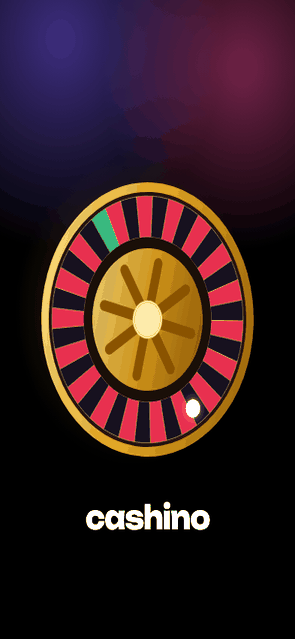

# Cashino

Plataforma móvil premium de **14 juegos de casino y azar con moneda 100 % virtual** (sin valor monetario, sin compras, sin retiradas), con Academy educativa, multijugador online, rankings y progresión. React Native + Expo, prioridad iPhone.

> La moneda son **fichas** sin valor monetario. Nombre e identidad: `src/config/brand.ts` y `app.config.ts`.



## Jugar ya
**https://reenillaa.github.io/Cashino/** — en el iPhone ábrelo en Safari → Compartir → *Añadir a pantalla de inicio* y se abre a pantalla completa como una app (se publica sola en cada push a `main`).

## Qué incluye
- **Todo se desbloquea**: se empieza con blackjack y póker; los demás juegos, las mesas en directo, las apuestas deportivas y cada deporte se compran con fichas (2.500, 5.000 y cada vez más).
- **29 juegos en el menú** (con Pesca Profunda y Pingüino Saltarín) y una **sala de tragaperras** con 7 máquinas: Mina de Oro (pepitas y re-tiradas, ≈95,8 % simulado), Fuego Frutal (comodines ×2/×3/×5, ≈97,6 %), Noche Pirata (loro comodín que camina, ≈95,5 %), Lago de Oro (tragaperras de pesca 5×3 con pescador que recoge peces en las gratis, retorno ≈95,6 % simulado), Templo de Jade (5×3 con símbolo especial que se expande, ≈97 % simulado), Dulce Cascada (tragaperras de cascada 6×5 con bombas multiplicadoras y tiradas gratis, retorno ≈96,5 % simulado), Carreras de caballos (apuestas de hipódromo, cámara de TV en 3D), Póker (Texas Hold'em NL vs bots y online), Video Póker (Jacks or Better), Rueda, Torre del Dragón, Diamantes, Globo (Pump), Dragon Tiger, Blackjack, Cohete (crash), Dados, Minas, Plinko, Cruza la calle (estilo chicken-road), Ruleta europea, Limbo, Cara o cruz, Bacará, Mayor o menor, Tragaperras y Bolsa (sube o baja). Keno y Sic Bo siguen en el motor pero fuera del menú.
- **Apuestas deportivas** con partidos reales (fútbol, F1, tenis, NFL, NBA, NHL, UFC), cuotas propias, sencillas y combinadas, y **cash out** antes de que empiecen (con cuenta).
- **Multijugador en directo**: carreras cada 2 min, ruleta y **cohete** cada 45 s, todos a la vez (con cuenta).
- **Ligas con amigos** (código privado, tabla semanal) y **pase de temporada** gratis de 30 niveles; ambos con puntos que se ganan jugando un poco cada día, nunca apostando más.
- **Tienda estética** (dorsos, tapetes, avatares, marcos, títulos) pagada con fichas de juego y **retos diarios y semanales**.
- Resultados **calculados antes de animar** y **verificables** (HMAC-SHA256, semillas servidor/cliente/nonce).
- **Guía opcional** por juego (botón «?»): oscurece la pantalla y señala el botón exacto que tocar, en la sala de práctica; se recuerda (`<juego>_tutorial_completed`).
- **Academy**: por juego, el modelo explicado con gráficos (probabilidades, lo que devuelve cada apuesta, «de cada 100 fichas», fórmula y ejemplo) y un simulador que juega miles de rondas reales con el motor; además 42 lecciones ES/EN con cuestionarios y 8 simuladores avanzados. Sin promesas de ganar.
- **Salas por juego** con carrusel animado: 🏠 Práctica (gratis), ☕️ El Bar 20–100, 🎩 El Club 200–1.000 y 💎 Sala VIP 2.000–10.000 (límites validados también en servidor).
- **Economía virtual** simulada: saldo inicial 1.000, regalo diario sin presión, recargas gratuitas, práctica ilimitada.
- **Progresión**: niveles, XP con topes diarios, logros, misiones diarias/semanales, temporadas de 56 días.
- **Online (Supabase)**: cuentas, amigos, bloqueos, equipos, salas privadas con código, Sit & Go, reacciones (sin chat), rankings que nunca usan el saldo.
- **Diseño estilo Offsuit**: negro puro, sin cajas ni bordes, tarjetas pastel con emoji grande por juego, números grandes en peso ligero, botones en píldora, control de apuesta − / + pensado para cualquiera, animaciones suaves al cambiar de pestaña y al entrar en cada juego, sonidos sintetizados “físicos” (fichas, cartas, marimba, monedas), hápticos y accesibilidad básica.

## Empezar
```bash
npm install
```
```bash
npx expo start
```
Sin variables de entorno la app funciona **entera en modo offline/invitado**. Para lo online, copia `.env.example` a `.env` y sigue `docs/09-IOS-INSTALL.md`.

Para ver la app en un iPhone necesitas un **development build** (usa módulos nativos que Expo Go no trae): ver `docs/09-IOS-INSTALL.md`.

## Scripts
| Script | Qué hace |
|---|---|
| `npm run typecheck` | TypeScript estricto |
| `npm test` | Jest: motor (100) + app (14) |
| `npm run test:engine` / `test:app` | Suites por separado |
| `./supabase/tests/run.sh` | Pruebas del esquema SQL en un Postgres local |
| `npm run sync:engine` | Copia el motor a las Edge Functions (antes de desplegar) |
| `npm run sim:economy` | Simulación de la economía |
| `npm run gen:sounds` / `gen:icons` | Regenera sonidos sintetizados / iconos desde `brand/` |
| `npm run export:web` | Build web (usada para verificación visual) |
| `npm run export:pages` | Build PWA para GitHub Pages bajo `/Cashino` |

## Estructura
```
src/app/          Rutas (Expo Router): pestañas, juego, academy, online, ajustes, auth
src/engine/       Motor puro TS (RNG verificable, 14 juegos, póker, bots, economía, rankings) + tests
src/games/        UI de cada juego + marco común (GameShell, apuesta, historial, reglas)
src/features/     academy, tutorial, play (sesiones), online, social, sync, economy, progression
src/design/       Tokens (colores, arte pastel por juego), tema, componentes
src/i18n/         es.ts / en.ts
src/state/        Stores persistidos (zustand)
src/services/     supabase, audio, hápticos, almacenamiento, aleatoriedad, notificaciones
supabase/         Migraciones (RLS), Edge Functions (game, rewards, account, poker), tests SQL
docs/             Documentación numerada + STATUS.md
brand/            Propuestas de icono y logotipo
```

## Documentación
1. [Investigación](docs/01-RESEARCH.md) · 2. [Dirección artística](docs/02-DESIGN-TITANIUM.md) · 3. [Arquitectura](docs/03-ARCHITECTURE.md) · 4. [Juegos y matemáticas](docs/04-GAMES-AND-MATH.md) · 5. [Offline y sincronización](docs/05-SYNC-OFFLINE.md) · 6. [Economía](docs/06-ECONOMY.md) · 7. [Seguridad](docs/07-SECURITY.md) · 8. [Rankings](docs/08-RANKINGS.md) · 9. [Instalar en iPhone](docs/09-IOS-INSTALL.md) · 10. [Pruebas](docs/10-TESTING.md) · [**Estado**](docs/STATUS.md)

## Aviso
Entretenimiento con moneda virtual. No hay dinero real, compras, retiradas ni premios con valor económico. Juega con moderación.

© Todos los derechos reservados. Software propietario.
